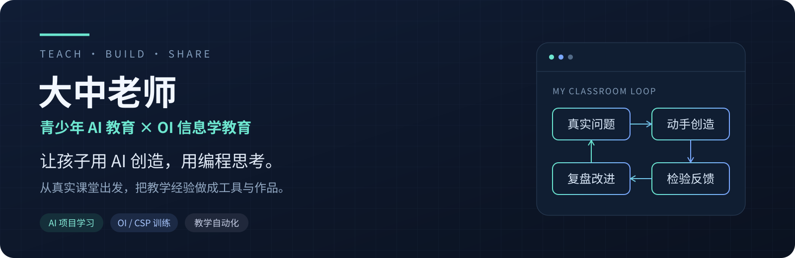

  

  <a href="https://moblm.com"><strong>上码 · 编程与 AI 学习</strong></a>
  &nbsp; · &nbsp;
  <a href="https://github.com/dazhongxinao-prog/code-collector"><strong>开源教学工具</strong></a>
  &nbsp; · &nbsp;
  <a href="https://github.com/dazhongxinao-prog/dazhongxinao-prog/issues"><strong>交流与反馈</strong></a>

## 你好，我是大中 👋

我专注于 **青少年 AI 教育与 OI 信息学教育**，在课堂里教，也动手做课程、工具和学习系统。

我希望孩子既能借助 AI 完成有意义的作品，也能通过编程训练，把问题想清楚、把方法讲明白、把结果验证好。

> **把任何重复 3 遍的事，AI 化或自动化。**
> 让老师把时间留给观察、反馈和陪伴，让孩子把时间用在思考与创造上。

## 我在做的事

| 方向 | 我关注的问题 |
| :--- | :--- |
| **AI 项目学习** | 把语文、数学、科学等学科主题变成能动手、能展示、能复盘的项目。 |
| **OI / CSP 训练** | 围绕 C++、算法与问题求解，连接练习、测评、错题与复练。 |
| **教学工具与自动化** | 减少收代码、整理资料和重复操作，让教学过程留下可追溯的证据。 |

## 从课堂长出来的工具

### [Code Collector · 代码回收系统 ↗](https://github.com/dazhongxinao-prog/code-collector)

为编程课堂、训练营和模拟考试整理代码：**提交 → 交卷锁定 → 统一归档 → 批量导出**。

早期公开版本，欢迎试用和反馈。目前定位为收卷工具，不提供自动判题。

[查看源码](https://github.com/dazhongxinao-prog/code-collector) · [阅读已知限制](https://github.com/dazhongxinao-prog/code-collector/blob/main/KNOWN_ISSUES.md)

### [上码 · 编程与 AI 学习 ↗](https://moblm.com)

持续建设面向教学的编程与 AI 学习平台，探索题库训练、AI 辅学与学习反馈如何形成连续的学习过程。

## 我做教育产品的几个坚持

- **先问为什么。** 从学生真正遇到的问题出发，再选择工具与技术。
- **作品要能解释。** 能说清思路、检验结果，才是学习的一部分。
- **反馈要有依据。** 不把一次答对当作掌握，也不把 AI 生成当作教学验收。
- **保护学生。** 公开分享通用方法与工具，不公开学员隐私和个人学习记录。

## 一起交流

欢迎围绕 **AI 项目课程、OI 训练、教学工具、机构教学实践** 交流。

可以在 [主页仓库 Issues](https://github.com/dazhongxinao-prog/dazhongxinao-prog/issues) 留下想法，也可以在具体工具仓库提交问题。

---

Teach with care. Build with purpose. Share what works.

